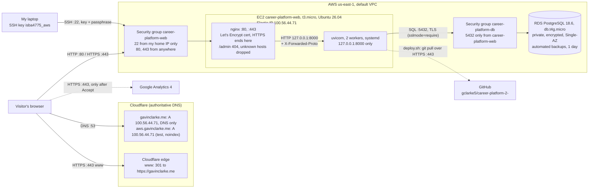
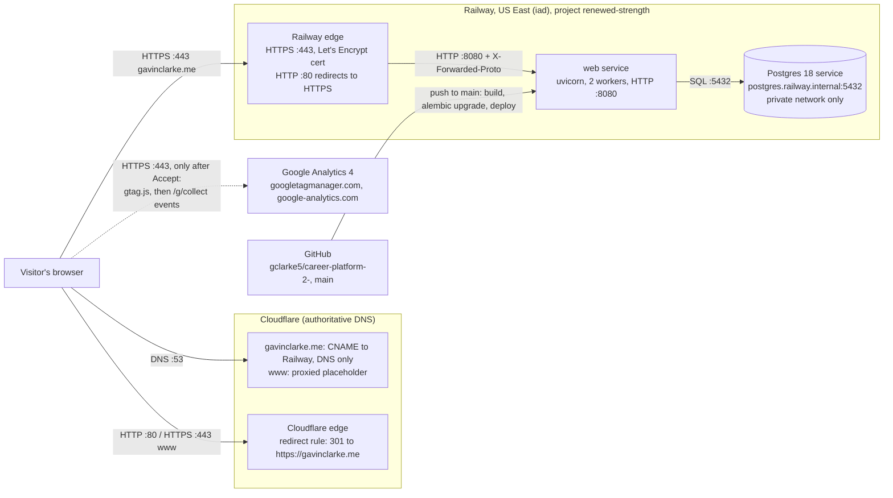
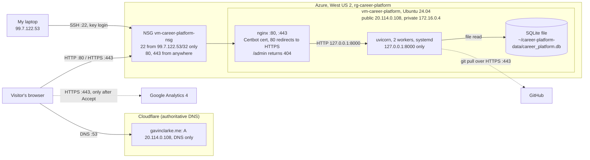
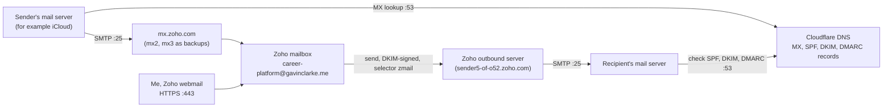

# Career Platform

**Live at [https://gavinclarke.me](https://gavinclarke.me).**

My personal career site, built for a class project. Recruiters and hiring
managers use it to see who I am, which analyst roles I'm aiming for (finance,
or operations and supply chain), my resume, and project write-ups, and to
contact me. It's a FastAPI app that reads its profile and projects from a
database. Production runs on AWS: an EC2 server with nginx, and PostgreSQL on
Amazon RDS. Local development uses SQLite ([why](docs/database-choice.md)).

The site started on an Azure VM (2026-10-08 to 2026-10-13), moved to Railway
on 2026-10-13, and moved to AWS on 2026-11-10 after Railway's trial ended.
Email is Zoho Mail, DNS is Cloudflare, and analytics is Google Analytics 4.
The Project 1 evidence is indexed in
[`docs/project-1-submission.md`](docs/project-1-submission.md); the AWS move
is recorded in [`docs/migration-notes.md`](docs/migration-notes.md).

Contents:
- [Architecture](#architecture)
- Setting up and running it:
  - [Local development](#local-development)
  - [Production on AWS](#production-on-aws)
  - [Rollback](#rollback)
- What happened:
  - [The migrations](#how-the-migration-preserved-the-data)
  - [Decisions](#decisions)
  - [Investigated failures](#investigated-failures)
  - [Limitations](#remaining-limitations)
- Upkeep and looking back:
  - [Costs and cleanup](#costs-and-cleanup)
  - [Reflection](#reflection)
  - [Next steps](#next-steps)

## Architecture

### Now: AWS EC2 + RDS (since 2026-11-10)



- **A page request:**
  1. The browser asks Cloudflare for `gavinclarke.me`. Cloudflare answers with
     the server's Elastic IP, because the record is DNS only.
  2. The browser opens HTTPS on port 443 to nginx on the EC2 server, which
     holds the Let's Encrypt certificate. Port 80 redirects to HTTPS.
  3. nginx forwards plain HTTP to uvicorn on `127.0.0.1:8000`. uvicorn trusts
     `X-Forwarded-Proto` only from `127.0.0.1`, so the app builds `https://`
     links.
  4. The app reads PostgreSQL on RDS over TLS. The database has no public
     address, and its security group only admits the web server's group.
- **Administration:** SSH from my home IP is the only way in. `/admin` is
  closed twice: the app only mounts it with `ENVIRONMENT=development`, and
  nginx returns 404 for it.
- **`www`:** Cloudflare's own edge answers it with a 301 redirect, so `www`
  traffic never reaches AWS.
- **Analytics:** only after the visitor accepts the banner, the browser itself
  sends events to Google, never through the server
  ([details](docs/evidence/analytics.md)).

### Before: Railway (2026-10-13 to 2026-11-07)

The trial ended on 2026-11-07, and the site was down until the AWS move on
2026-11-10. This is how it ran; details are in
[`docs/evidence/railway-migration.md`](docs/evidence/railway-migration.md).
Railway terminated HTTPS, deployed every push to `main`, and ran Postgres on
its private network.



- **A page request:**
  1. The browser asks Cloudflare for `gavinclarke.me`. Cloudflare answers
     with Railway's address, because the record is DNS only.
  2. The browser opens HTTPS on port 443 to Railway's edge, which holds the
     certificate.
  3. The edge forwards plain HTTP to uvicorn on port 8080 inside Railway.
  4. The app reads Postgres over Railway's private network. Postgres has no
     public address.
- **`www`:** Cloudflare's own edge answers it with a 301 redirect, so `www`
  traffic never reaches Railway.
- **Analytics:** only after the visitor accepts the banner, the browser itself
  sends events to Google, never through Railway
  ([details](docs/evidence/analytics.md)).

### Before: Azure VM (2026-10-08 to 2026-10-13)



On the VM, I ran everything myself:
- nginx was the only public entry point;
- the app listened only on `127.0.0.1`;
- the database was a file on the VM's disk, with no network port;
- I deployed code by SSHing in, running `git pull`, then
  `sudo systemctl restart career-platform`.

Details are in [`docs/evidence/azure-vm.md`](docs/evidence/azure-vm.md).

### Email (Zoho Mail)



- **Incoming:** a sender's server looks up the MX records in Cloudflare and
  delivers over SMTP to Zoho.
- **Outgoing:** Zoho signs each message with my DKIM key and sends it. The
  receiving server then checks SPF, DKIM and DMARC against my DNS records.

Mail doesn't involve the VM, Railway or AWS at all, so it kept working through
every move, including the days the site was down. The tests and records are in [`docs/evidence/ex06.md`](docs/evidence/ex06.md),
and the header analysis is in
[`docs/evidence/zoho-header-check.md`](docs/evidence/zoho-header-check.md).

## Analytics

Google Analytics 4 (`G-FVPBZ69VK0`, set by the `GA_MEASUREMENT_ID` variable)
loads only after a visitor accepts the consent banner (`static/js/consent.js`).
Setup, verification and what the events show are in
[`docs/evidence/analytics.md`](docs/evidence/analytics.md).

## Local development

Local work stays on SQLite. Nothing here touches production.

```bash
cp .env.example .env          # DATABASE_URL=sqlite:///./career_platform.db, ENVIRONMENT=development
uv sync                       # or: python -m pip install -r requirements.txt
uv run alembic upgrade head   # migrates whatever DATABASE_URL names
uv run uvicorn app.main:create_app --factory --reload
```

The site is at `http://127.0.0.1:8000`. `/admin` is served only when
`ENVIRONMENT=development` (the `.env` above sets it) and the app is not on
Railway. `ENVIRONMENT` defaults to `production`, and outside development the
app refuses to start on SQLite.

Tests run on SQLite by default. Set `TEST_DATABASE_URL` to also run them
against a local Postgres:

```bash
uv run pytest
TEST_DATABASE_URL=postgresql://localhost/career_test uv run pytest
```

## Production on AWS

The move from Railway is planned in
[`docs/superpowers/plans/2026-11-10-aws-ec2-rds-migration.md`](docs/superpowers/plans/2026-11-10-aws-ec2-rds-migration.md)
and recorded, with every check, in
[`docs/migration-notes.md`](docs/migration-notes.md).

| Piece | Where |
|---|---|
| Account | AWS `874754748309`, region `us-east-1`, IAM user `isba-student` (CLI profile `isba-4775`) |
| Server | EC2 `career-platform-web` (`i-0bc13a8b3e864e62e`), t3.micro, Ubuntu 26.04, 20 GiB encrypted gp3, IMDSv2 only |
| Address | Elastic IP `100.56.44.71` |
| Database | RDS `career-platform-db`, PostgreSQL 18.6, db.t4g.micro, database `career_platform`, user `career_admin` |
| Firewalls | Security groups `career-platform-web` (22 from home IP; 80, 443 public) and `career-platform-db` (5432 from `career-platform-web` only) |
| Code on the server | `/home/ubuntu/career-platform`, systemd service `career-platform`, nginx site `career-platform` |
| Secrets | `/etc/career-platform.env` (`root:ubuntu`, 640) on the server; the database password on my laptop in `~/.config/career-platform/aws-db-password`. Never in Git |
| DNS | Cloudflare: `@` and `aws` are A records to the Elastic IP, DNS only |
| `www` | Redirected by Cloudflare (see below) |

The server's config lives in the repo in [`deploy/`](deploy/): the systemd
unit, the nginx site, and `deploy.sh`. Certbot added the HTTPS parts of the
nginx site on the server; the certificate covers `gavinclarke.me` and
`aws.gavinclarke.me` and renews itself (`certbot.timer`).

### `www.gavinclarke.me`

In Cloudflare, `www` is an A record to the placeholder `192.0.2.1`,
**proxied** (orange cloud), and a redirect rule ("Redirect www to the root
domain") answers every `www` request with a 301 to `https://gavinclarke.me`,
keeping the path and query string. The placeholder address is never
contacted. Don't switch `www` to DNS only, or the redirect stops and the name
points nowhere.

### Variables in `/etc/career-platform.env`

| Variable | Value |
|---|---|
| `DATABASE_URL` | `postgresql://career_admin:…@career-platform-db.ce1ou2ak2srg.us-east-1.rds.amazonaws.com:5432/career_platform?sslmode=require` |
| `ENVIRONMENT` | `production` (also the default, so `/admin` stays off if it's missing) |
| `GA_MEASUREMENT_ID` | `G-FVPBZ69VK0` |
| `GIT_COMMIT_SHA` | written by `deploy.sh`, shown by `/health` |

The app refuses to start on SQLite unless `ENVIRONMENT=development`, so a
missing `DATABASE_URL` stops the service instead of serving an empty site.

### Deploys

Deploys are manual. Merge to `main`, then:

```bash
ssh -i ~/.ssh/isba4775_aws ubuntu@100.56.44.71 '~/career-platform/deploy/deploy.sh'
```

`deploy.sh` pulls `main`, runs `uv sync --frozen --no-dev` and
`alembic upgrade head`, writes the commit into the env file, restarts the
service, and waits until `/health` reports a healthy database at the new
commit. If that doesn't happen, it prints the service's last log lines and
fails. `BRANCH=<name>` deploys another branch.

Deploys never seed. Migrations build the schema and insert nothing, and a test
fails if one ever does.

### Changing content

RDS is the source of truth; the local SQLite file is not.

1. Open a tunnel to RDS through the server (it stays open; stop it with
   Ctrl-C):

   ```bash
   ssh -i ~/.ssh/isba4775_aws -N -L 15433:career-platform-db.ce1ou2ak2srg.us-east-1.rds.amazonaws.com:5432 ubuntu@100.56.44.71
   ```

2. In another terminal, run the app locally against it and use `/admin` at
   `http://127.0.0.1:8000/admin`. The password is read from the file, so it's
   never printed:

   ```bash
   DATABASE_URL="postgresql://career_admin:$(cat ~/.config/career-platform/aws-db-password)@127.0.0.1:15433/career_platform?sslmode=require" \
     ENVIRONMENT=development uv run uvicorn app.main:create_app --factory
   ```

   The live site shows the change on the next request, with no redeploy.
3. If you changed the profile, experience or `site_meta`, update
   `app/fallback_data.py` to match. Projects have no fallback copy.

Schema changes are ordinary Alembic migrations; `deploy.sh` applies them.

### Working from somewhere else (campus)

SSH only accepts my home IP. Elsewhere:

1. EC2 → Security Groups → `career-platform-web` → Edit inbound rules.
2. Add SSH from **My IP**, description `temporary`.
3. Do the work.
4. Delete that rule before leaving.

### Checking on it

```bash
curl -s https://gavinclarke.me/health   # "commit" is the short SHA that's live
ssh -i ~/.ssh/isba4775_aws ubuntu@100.56.44.71 'systemctl status career-platform --no-pager; sudo journalctl -u career-platform -n 50 --no-pager'
ssh -i ~/.ssh/isba4775_aws ubuntu@100.56.44.71 'sudo tail -n 50 /var/log/nginx/access.log'
```

## Rollback

Code and data roll back separately. Deploying an old version restores the code
only: it never undoes a migration or a content edit.

### Backups

- **Automatic:** RDS takes a daily snapshot and keeps transaction logs, so the
  database can be restored to any moment in the last **1 day** (the most the
  account's Free plan allows). These backups live inside AWS and are deleted
  with the database.
- **Before any risky change, or before deleting anything in AWS,** take a copy
  outside AWS. It streams straight to the laptop, so nothing is left on the
  server:

  ```bash
  F=../railway-move/aws-rds-career-platform-$(date +%Y-%m-%d-%H%M%S).dump   # outside the repo
  (umask 077; ssh -i ~/.ssh/isba4775_aws ubuntu@100.56.44.71 \
    'set -a; . /etc/career-platform.env; set +a; pg_dump -Fc --no-owner --no-acl "$DATABASE_URL"' > "$F")
  /opt/homebrew/opt/postgresql@18/bin/pg_restore --list "$F" | grep -c 'TABLE DATA'   # expect 10
  ```

### Application code (no migration involved)

1. **Revert it in Git:** `git revert <bad commit>` on a branch, run the tests,
   open a PR and merge it.
2. **Deploy** with `deploy.sh` as above.
3. **Check:** `/health`'s `"commit"` shows the revert, and the pages that broke
   work again.

### Schema changes (a migration was involved)

Old code can't start against a newer schema: `alembic upgrade head` fails with
`Can't locate revision identified by '…'`. So downgrade the database **first,
using the current code**, which still has the migration's `downgrade()`:

1. **Back up** (above). A downgrade can drop columns or tables, and the data
   in them.
2. **Find the target revision:** the old commit's newest file in
   `migrations/versions/`.
3. **Downgrade on the server:**

   ```bash
   ssh -i ~/.ssh/isba4775_aws ubuntu@100.56.44.71 \
     'cd ~/career-platform && ~/.local/bin/uv run --no-sync --env-file /etc/career-platform.env alembic downgrade <old revision>'
   ```

4. **Roll the code back** as in "Application code" above.
5. **Check:** `/health` is healthy with `"fallback": false`, and the pages
   render their content.

### Content (a bad edit in the database)

- **One row or a few:** fix them through the tunnel (see "Changing content").
- **Everything, within the last day:** RDS → Databases → `career-platform-db`
  → Actions → **Restore to point in time**. This creates a *new* database;
  point `DATABASE_URL` in `/etc/career-platform.env` at its endpoint and
  restart the service, then delete the old one once the site checks out.
- **From an export:** restore it into an empty database with
  `pg_restore --no-owner --no-acl --exit-on-error`, as on 2026-11-10
  ([`migration-notes.md`](docs/migration-notes.md)).

## Fallback

If the database is unreachable, every public page still renders the profile
from `app/fallback_data.py`, and connections fail fast so pages don't hang.
Projects have no fallback: `/`, `/projects` and `/projects/<slug>` say
"Projects temporarily unavailable" and return **503**, and the next request
after the database recovers shows them again, with no restart. An empty
`projects` table shows "No projects yet" with a 200. `/health` reports `{"database": "unavailable", "fallback": true}` in that
state. It checks connectivity only, so `"healthy"` doesn't mean the tables
have content.

## The old Azure VM

The site used to run on an Azure VM, `vm-career-platform` in
`rg-career-platform` (nginx, systemd, SQLite). No DNS record points to it any
more. It is **deallocated on purpose**: it isn't deleted, and its disk, its
SQLite data and its static IP (`20.114.0.108`) are kept, but it serves nothing
until it is started. An auto-shutdown schedule also turns it off at 19:00
Pacific every day. The disk and IP still cost a little each month; see
[`docs/costs.md`](docs/costs.md).

**As of 2026-10-26 the Azure free-trial subscription is disabled and read-only**,
so `az vm start` is refused and the steps below can't run until it is
re-enabled. See [`docs/evidence/azure-vm.md`](docs/evidence/azure-vm.md) for
how the VM ran.

nginx only answers for `gavinclarke.me`, so a request to the bare IP gets a
404. To roll back to the VM:

1. Start it, and turn off auto-shutdown so it stays up:

   ```bash
   az vm start -g rg-career-platform -n vm-career-platform
   az vm auto-shutdown -g rg-career-platform -n vm-career-platform --off
   ```

2. Check that it serves the site before moving any traffic. Expect
   `Server: nginx/1.24.0 (Ubuntu)` and `"fallback": false`:

   ```bash
   curl -sI --resolve gavinclarke.me:443:20.114.0.108 https://gavinclarke.me/ | grep -i ^server
   curl -s --resolve gavinclarke.me:443:20.114.0.108 https://gavinclarke.me/health
   ```

   Certbot only renews the VM's certificate while the VM is running. If
   `curl` reports a certificate error, SSH in and run `sudo certbot renew`.
   The SSH rule only allows one home IP, so from anywhere else you'll need a
   temporary rule (see `docs/evidence/ex03.md`, section 4).

3. In Cloudflare, change `@`'s A record to `20.114.0.108`, DNS only (grey
   cloud).

The VM has the content as it was on 2026-10-13. Anything changed since then
isn't on it, so copy the current database back to the VM before step 3 (the
method is in [`docs/evidence/railway-migration.md`](docs/evidence/railway-migration.md),
section 6). With AWS running, the VM is a last resort.

To stop it again, deallocate it. `--off` above deletes the auto-shutdown
schedule, so set it again too (the CLI takes UTC: `0200` is 19:00 Pacific
daylight time):

```bash
az vm deallocate -g rg-career-platform -n vm-career-platform
az vm auto-shutdown -g rg-career-platform -n vm-career-platform --time 0200
```

## How the migration preserved the data

### Railway to AWS (2026-11-10)

Railway's trial ended on 2026-11-07 before the move, so the source was the
last backup: a `pg_dump` of Railway's Postgres taken on 2026-11-03, which had
been restore-tested that day (all 10 tables matched Railway's row counts and
content fingerprints) and checked again by SHA-256 on the server. Nothing was
edited after 2026-11-03.

- `pg_restore --no-owner --no-acl --exit-on-error` into the empty RDS database,
  then `alembic upgrade head`, which found it already at `d4a8f1c2e7b9`.
- Every row (21) and every sequence value (9) on RDS was compared with the
  backup file's data: identical.
- All pages render the restored content on `gavinclarke.me`, and `/health`
  reports a healthy database with no fallback.

The full record, including what differed from the plan, is
[`docs/migration-notes.md`](docs/migration-notes.md).

### Azure VM to Railway (2026-10-13)

The plan was written first:
[`2026-10-08-railway-postgres-migration.md`](docs/superpowers/plans/2026-10-08-railway-postgres-migration.md),
committed on 2026-10-08, five days before the domain moved on 2026-10-13. The
full record, written afterward on 2026-10-26, is
[`docs/evidence/railway-migration.md`](docs/evidence/railway-migration.md).

- **The data didn't travel through Git.** I took a consistent `.backup`
  snapshot of the VM's SQLite database. `python -m app.content_copy` copied it
  once into an empty Postgres and reset the id sequences. Deploys never seed,
  and a test fails if a migration ever inserts content.
- **It's the real data, not the seed.** The seed writes 1 profile row. The VM
  had 19 rows, including the project categories and `site_meta` I added on
  2026-10-08, which no seed or migration writes.
- **It was checked record by record.** On 2026-10-26, all 19 VM rows were
  identical in Postgres, column for column. The rendered pages matched too,
  apart from the project added in Postgres after the move.
- **The rollback carries newer data back.** It copies Postgres into a fresh
  SQLite file before DNS would point back at the VM. That copy was tested on
  2026-10-26.

**Responsibilities that moved to Railway:**
- the operating system;
- the web entry point (nginx's job);
- TLS certificates (Certbot's job);
- keeping the process running (systemd's job);
- running the database server.

**Still mine:**
- the code and its packages;
- the configuration and secrets;
- the data and its backups (the Trial has no built-in backups);
- migrations;
- DNS;
- costs.

The full who-manages-what table is in section 7 of the migration record.

## Decisions

| Decision | Alternatives considered | Why | Where it's written |
|---|---|---|---|
| **Move from the Azure VM to Railway + PostgreSQL** | Stay on the VM; Railway with SQLite on a volume | The course moves to a platform-as-a-service. Railway deploys on every push to `main`, terminates TLS and runs Postgres for me, so I stop patching an OS and renewing certificates. A SQLite file in a Railway container would be wiped on every deploy, so Postgres it is. The cost: a trial that ends, one custom domain, and less control | [Migration plan](docs/superpowers/plans/2026-10-08-railway-postgres-migration.md) (written before, 2026-10-08), [database choice](docs/database-choice.md) |
| **Managed email (Zoho Mail) instead of self-hosted** | A mail server (Postfix and Dovecot) on the VM; Namecheap's email forwarding | Running my own mail server means more open ports, spam filtering, patching, and a new IP address that big providers don't trust. Azure also restricts outbound port 25 on most subscriptions. Namecheap forwarding can receive but can't send as my domain with DKIM. Zoho's free plan gives a real mailbox with MX, SPF and DKIM values to publish, and mail keeps working whichever host runs the website | Written afterward, 2026-10-26 (this README). Results: [`ex06.md`](docs/evidence/ex06.md) |
| **`www` redirected by Cloudflare** | A second custom domain on Railway; a paid Railway plan | The Trial allows one custom domain per service. A proxied placeholder `www` record plus a Cloudflare redirect rule keeps one address for free, with a valid certificate | [`domain-https.md`](docs/evidence/domain-https.md) |
| **Move from Railway to AWS EC2 + RDS** | EC2 with Postgres on the same server; Lambda + API Gateway + RDS | The course moves to AWS, and Railway's trial ended. EC2 + RDS teaches the core services, keeps the database managed (backups, patching) and private, and runs the app the way the Azure VM did. The cost: about $27/month on credits, and a server to patch again | [AWS plan](docs/superpowers/plans/2026-11-10-aws-ec2-rds-migration.md) (written before, 2026-11-10), [migration notes](docs/migration-notes.md) |
| **Opt-in analytics** | Load GA on every page | Nothing goes to Google unless the visitor accepts, so the privacy page is true. The cost: the numbers undercount visitors | [`analytics.md`](docs/evidence/analytics.md) |

## Investigated failures

Each one records the symptom, what I checked, the diagnosis, the repair, and
the repeated check.

| Failure | Kind | Symptom | Checks | Diagnosis and repair | Repeated check |
|---|---|---|---|---|---|
| **Data check said the VM's database differed from my laptop's** ([`ex03.md`](docs/evidence/ex03.md), section 3) | Application / database, real, during the Azure move | The `sqlite3 .dump` hashes from the two machines didn't match | Row counts per table; `/proc/<pid>/fd` showed which file the app had open; the profile row and homepage | The machines run different `sqlite3` versions (3.54 and 3.45), which format `.dump` output differently. The data was fine. I switched to hashing the database file itself | `sha256sum` of the file matched on both sides (`2a19d5ba…72b52`), checked again with the app running |
| **A merge never deployed** (PR #22, 2026-10-21) | Deployment, real, on Railway | The site still ran the PR #21 build hours after PR #22 was merged | `railway deployment list -s web`: the newest deployment was `e5d4c90` (PR #21), with no failed or skipped attempt for `f72dc41` | Railway never started a deploy for that push. I didn't confirm why. Repaired by "Deploy Latest Commit" in the dashboard. I then added `"commit"` to `/health` (PR #28), so the live commit shows at a glance | Deployment `f72dc41`: SUCCESS on 2026-10-26, `/health` healthy. Every merge since (PRs #23–#31) deployed by itself, and `/health` showed each merge commit |
| **TLS hostname mismatch** ([`ex05.md`](docs/evidence/ex05.md)) | DNS / TLS, **a deliberate lab failure** with simulated output from the exercise | `curl: (60) SSL certificate problem: certificate subject name does not match target host name` | `dig` (DNS resolved fine), `curl -Iv` (certificate subject `CN=old-vm.lab.example`) | The server presented a certificate for another host name. Repair: install a certificate for `site.lab.example` | The supplied follow-up showed `SSL certificate verify ok` and `HTTP/2 200` |
| **Old MX records still showing after the switch** (Exercise 06, 2026-10-15) | DNS, real | After I deleted Namecheap's MX records, Google's `8.8.8.8` still returned `eforward1` | Asked Cloudflare's name servers (`liz`, `sevki`) directly: they were already clean | A cached answer at the resolver. It expired with the 300-second TTL. Along the way, one "NXDOMAIN" turned out to be my command: zsh didn't split `$q` into two words for `dig` | `dig @8.8.8.8 MX gavinclarke.me` returned only Zoho's three records. Rechecked on 2026-10-26: still the same on `8.8.8.8` and Cloudflare |

[Exercise 04](docs/evidence/ex04.md) is my own explanation of how HTTPS
secured the site on the VM.

## Remaining limitations

- **The Azure subscription is disabled (found 2026-10-26).** The VM can't
  start, so I couldn't run a timed reboot test, and the rollback to the VM
  can't run until the subscription is re-enabled. The VM's resources may
  eventually be deleted ([`azure-vm.md`](docs/evidence/azure-vm.md)).
- **No recorded renewal check on the VM.** Certbot's renewal was never
  tested with `--dry-run` while the VM was live, and it can't be now
  ([`domain-https.md`](docs/evidence/domain-https.md), section 5).
- **No email test before MX.** I didn't send a message before Zoho's MX
  records existed. The domain always had Namecheap's forwarding MX records
  before that ([`ex06.md`](docs/evidence/ex06.md)).
- **The address isn't resume-style.** It's `career-platform@` rather than
  `gavin@`. An alias would fix that without DNS changes.
- **DMARC is `p=none`.** Receivers report failing mail but don't block it.
- **RDS keeps only 1 day of backups.** The account's Free plan refuses more,
  and those backups are deleted with the database. Longer-term copies are
  exports taken outside AWS (see [Rollback](#rollback)).
- **One server, one database zone.** If the EC2 instance fails, the site is
  down until it's rebuilt from `deploy/` and the migration notes (about an
  hour). The data is safe in RDS.
- **The app connects as the RDS master user.** A separate user with fewer
  rights would limit the damage of a leaked env file.
- **Policy gap:** the class IAM policy's rule against making the database
  public probably doesn't cover changes after creation, so never change that
  setting.
- **During a database outage, the profile comes from `app/fallback_data.py`.**
  That includes the home page's "What I've done so far" list. It's only as
  current as that file.
- **Not tested yet on AWS:** a point-in-time restore of RDS, and a schema
  downgrade on the server.
- **No CI, and deploys are manual:** tests run locally before each PR, and
  `deploy.sh` runs over SSH.

## Costs and cleanup

The details and amounts are in [`docs/costs.md`](docs/costs.md).

| Service | Plan and cost | Ends or renews | Cleanup plan |
|---|---|---|---|
| AWS | Free plan, $100 in credits. EC2 t3.micro, RDS db.t4g.micro, 40 GB of gp3 storage and a public IPv4 address: **about $26.82/month** | Credits run out around **2027-03-03** | Move to a cheaper setup (about $8–10/month) by the end of February 2027. Take an export outside AWS before deleting anything |
| Railway | Trial, $5 credit | **Ended 2026-11-07** | Done 2026-11-10: project deleted, SSH key `gavin-laptop` removed, `_railway-verify` TXT record deleted |
| Azure | Free trial, $5.46 used to 2026-10-20. **Subscription disabled (read-only) on 2026-10-26** | — | Keep the VM until the instructor says otherwise (see limitations). Then delete `rg-career-platform` |
| Domain `gavinclarke.me` | $0 for the first year (GitHub Student Pack), Namecheap | Expires 2027-10-08 | Renew at Namecheap's regular price, or let it lapse after the course |
| Zoho Mail | Free plan | — | Keep. Add a `gavin@` alias |
| Cloudflare | Free plan | — | Keep. `@` points at AWS since 2026-11-10 |
| Google Analytics | Free | — | Keep |

## Reflection

**What I understand better:**

One of the biggest things I learned is how layered this project is. From DNS, to TLS, to the Proxy, the application server and finally the database. When troubleshooting, understanding these concepts made it much easier and made my prompting with my claude agent in VS code more efficient. Instead of “guestimating” the issue, I went through a structured process of asking contextual questions and targeting possible diagnoses based on the findings. For example, the dig, curl -v was very important in narrowing down the root cause of an issue.

Another important thing I learned is how to properly use Railway after successfully migrating my site from Azure VM. I assumed Railway would manage more than Azure VM and I would not have to do as much maintenance. However, it did not manage as much as I expected. I was still responsible for managing data, migrations and most importantly billing costs. This gave me great experience with getting comfortable with a system like Railway and has inspired me to use it further for future website endeavors I have planned.

Lastly, I learned that just because my agent generated the code, did not automatically mean it would roll back along with my data. I could use past deployments for rollbacks but deployments and database changes needed to be managed individually.

**What I would change:**

If I were to do this project again, I would have put tests and verifications earlier on in the development process. I would have placed a before-MX test and timed reboot test in my original plan instead of just reversing the process and going backwards. That would have organized the process better but I also could have prompted Claude better as I repeated some confusing prompts during this process that made the agent double guess its decisions and rethink it.

I also would have adjusted to the format of the website earlier on. That way I could check up on the live site format more consistently throughout the project thus giving me more opportunity to format it closer to my exact liking. This would include doing CI tests automatically wherever I made a pull request. This would allow me to find possible issues earlier on in the pre-deployment process.

Finally, I would have checked up on deployments to Railway more myself as opposed to just relying more so on the claude agent in VS code. This is more of a self reflection as this does not reflect the process or agents decision making. At times I got lazy. Next time I would simply just pay more attention to each deployment and reflect on it by myself without help of ai so I can not only understand the process more, but make better prompts and decisions with my agent moving forward.

## Next steps

- **By the end of February 2027:** move to a setup that costs about $8–10 a
  month before the AWS credits run out, so the site stays up for employers.
- Give the app its own database user with only the rights it needs.
- Run tests on GitHub for each PR, and practise an RDS point-in-time restore.

## Project history

- **Spec:** [`resume-career-platform-spec.md`](docs/superpowers/specs/resume-career-platform-spec.md),
  committed on 2026-09-22.
- **Plans.** The date in each file name is when the plan was started. The
  first commit shows when it entered Git:

  | Plan | First committed |
  |---|---|
  | [Build](docs/superpowers/plans/2026-09-17-resume-career-platform.md) | 2026-09-22, with the spec, after the first build commit (2026-09-17) |
  | [Azure VM move](docs/superpowers/plans/2026-09-24-azure-vm-migration.md) | 2026-10-07 |
  | [Operating the VM](docs/superpowers/plans/2026-10-01-operate-the-vm.md) | 2026-10-08 |
  | [Railway move](docs/superpowers/plans/2026-10-08-railway-postgres-migration.md) | 2026-10-08, five days before the cutover |
  | [AWS move](docs/superpowers/plans/2026-11-10-aws-ec2-rds-migration.md) | 2026-11-10, before any AWS resource was created |

  The plans also hold the results recorded while each step ran.
- **Evidence:** indexed by requirement in
  [`docs/project-1-submission.md`](docs/project-1-submission.md).
- **Commits:** since 2026-10-13, every change to `main` has come through a
  pull request (`git log --first-parent --no-merges main` lists no direct
  commits).
