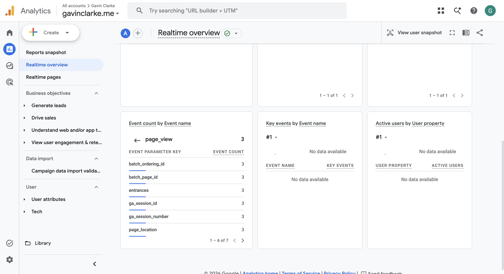
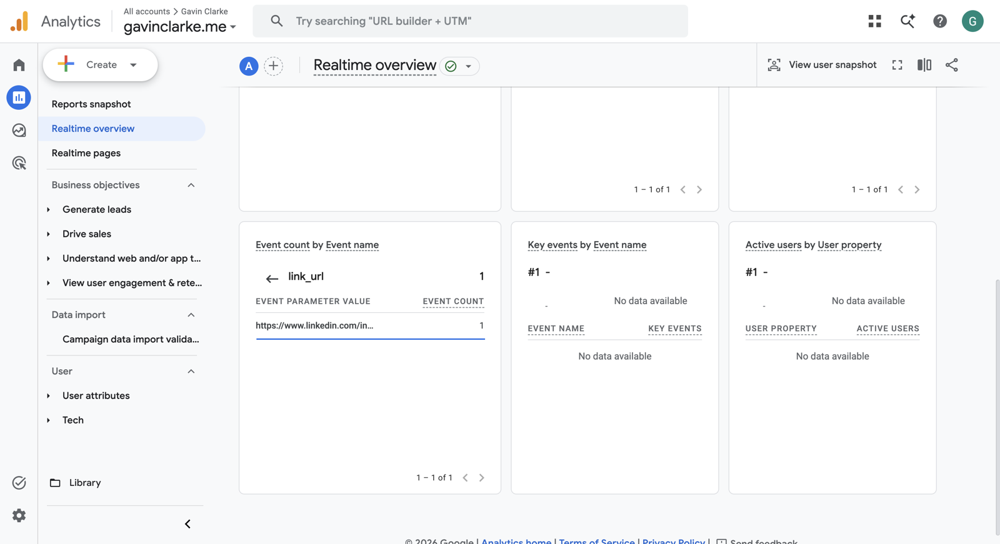
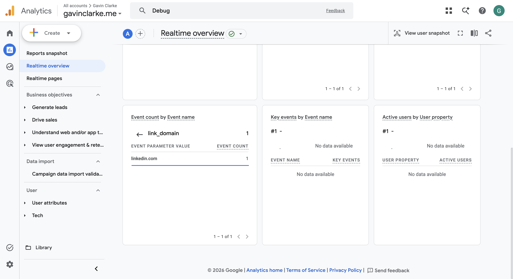
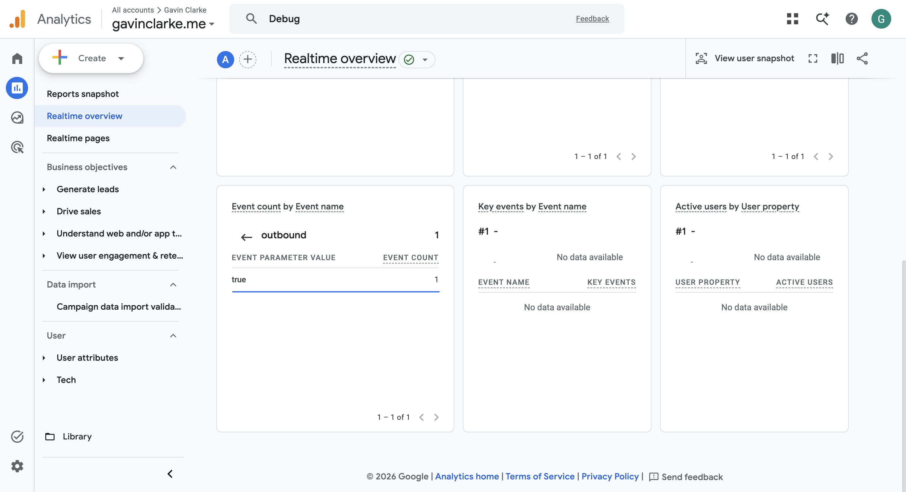

# Measuring activity with Google Analytics

Written on 2026-10-26. The Realtime screenshots are from 2026-10-20, and the
browser check in section 4 was run on 2026-10-26 against the live site.

## 1. How it's set up

| Piece | Value |
|---|---|
| GA4 property | Web data stream for `https://gavinclarke.me`, measurement ID `G-FVPBZ69VK0` |
| Enhanced measurement | On for the stream, including **Outbound clicks**, so GA records clicks on links to other domains without extra code. The `click` events below, with `outbound=true`, come from this setting |
| Where the ID lives | Railway variable `GA_MEASUREMENT_ID` on `web`. It isn't a secret (it's visible in every page's source), but keeping it out of the code means local copies of the site don't send data |
| Page code | `templates/base.html` renders the consent banner and loads `static/js/consent.js` with `data-ga-id="G-FVPBZ69VK0"` |
| Consent | Opt-in. Nothing loads from Google until the visitor clicks **Accept**. **Decline**, or the footer's "Analytics settings", turns it off and deletes the `_ga` cookies |
| Privacy settings | The tag sets `allow_google_signals: false` and `allow_ad_personalization_signals: false`, matching the [privacy page](https://gavinclarke.me/privacy) |

## 2. From the visitor's browser to Google Analytics

1. **The page loads with no analytics.** `consent.js` checks for a saved
   choice in `localStorage`. With none saved, it shows the banner and loads
   nothing from Google.
2. **The visitor clicks Accept.** `consent.js` saves the choice, sets up
   `window.dataLayer` and the `gtag()` function, queues
   `gtag("config", "G-FVPBZ69VK0", …)`, and adds Google's tag script
   (`https://www.googletagmanager.com/gtag/js?id=G-FVPBZ69VK0`) to the page.
3. **The tag sends a page view.** When the tag loads, it sets two first-party
   cookies, `_ga` (a random client ID) and `_ga_FVPBZ69VK0` (the session). It
   then sends a `page_view` event to `https://www.google-analytics.com/g/collect`.
   The request carries the measurement ID (`tid`), the page URL (`dl`), the
   client ID and the event name (`en=page_view`).
4. **Enhanced measurement watches for outbound clicks.** When the visitor
   clicks a link to another domain, the tag sends a `click` event with
   `link_url`, `link_domain` and `outbound=true`. GA batches events, so this
   request goes out a few seconds after the click, or when the page is closed.
5. **Google processes the hits.** They appear in **Realtime** within seconds,
   and in the standard reports after Google's processing delay, up to about a
   day.

On later pages the saved choice skips the banner, and steps 2–4 run straight
away.

## 3. Verified in Realtime (2026-10-20)

**What I did:**
1. Opened `https://gavinclarke.me` in my browser and clicked **Accept**.
2. Browsed the site.
3. Clicked the LinkedIn link.

**What I saw** in GA4 → Reports → Realtime overview, in the "Event count by
Event name" card:
- `page_view`, 3 events;
- one `click`, whose three parameters each needed a separate screenshot,
  because Realtime shows one parameter at a time:
  - `link_url`: `https://www.linkedin.com/in/gavin-clarke-81489329b`;
  - `link_domain`: `linkedin.com`;
  - `outbound`: `true`.

## 4. The same path checked in the browser's network traffic (2026-10-26)

I drove headless Chrome against the live site with the Chrome DevTools
Protocol and logged every request to a Google domain. The browser used a
fresh profile with no saved choice:

| Time (UTC) | Action | What the browser sent |
|---|---|---|
| 19:47:32 | Loaded `https://gavinclarke.me/` | Banner shown. **0** requests to Google, no cookies |
| 19:47:32 | Clicked **Accept** | `GET www.googletagmanager.com/gtag/js` |
| 19:47:33 | (tag loaded) | `www.google-analytics.com/g/collect`: `tid=G-FVPBZ69VK0`, `en=page_view`, `dl=https://gavinclarke.me/`. Cookies `_ga` and `_ga_FVPBZ69VK0` set |
| 19:47:37 | Clicked the LinkedIn link | — |
| 19:47:42 | (batched, 5 s later) | `www.google-analytics.com/g/collect`: `en=click`, `ep.link_url=https://www.linkedin.com/in/gavin-clarke-81489329b`, `ep.link_domain=linkedin.com`, `ep.outbound=true` |

**Declining, in a second fresh profile:** clicking **Decline**, reloading the
page and clicking the LinkedIn link sent **0** requests to Google and set no
`_ga` cookies.

**A failed first try:** in my first run, a plain click made the same tab
navigate to LinkedIn before the batched `click` hit was sent, so only the
`page_view` was captured. Clicking with ⌘ held, which opens LinkedIn in a new
tab, kept the site's tab open, and the `click` hit appeared. In a normal
browser, GA sends pending events when the page is closed, which is how my
own click on 2026-10-20 reached Realtime.

## 5. What the checks show

- **Configuration:**
  - the live pages carry the right measurement ID;
  - the tag loads only after consent;
  - both events reach this GA4 property.
- **The page view:** collection works end to end. Google's collect endpoint
  received the hit, and Realtime counted it.
- **The outbound click:** enhanced measurement is on and recording the useful
  interaction, including where the visitor went.
- **Consent works both ways:** before Accept, and after Decline, nothing is
  sent to Google. So the privacy page's promise holds.

## 6. Why these events are useful

- **`page_view`:** shows which pages visitors actually read. That tells me
  whether recruiters get past the home page to my resume and project write-ups,
  and which projects get attention.
- **The outbound `click` on LinkedIn:** is the closest thing this site has to
  a conversion: the visitor wanted to know more or get in touch. `link_url`
  shows which outside link they used, so I can tell which links get followed
  and whether a page change leads to more of these clicks.

The numbers only include visitors who accept analytics, so they undercount
real traffic. That's the cost of making analytics opt-in.
