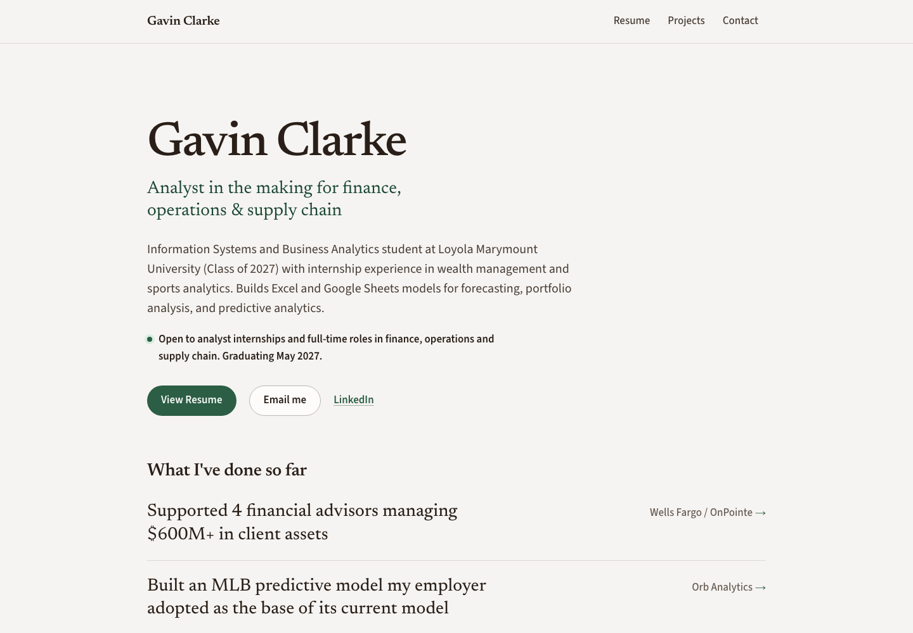

# Exercise 03: Build it, then move it

## 1. The VM

| Item | Value |
| --- | --- |
| VM name | `vm-career-platform` |
| Resource group | `rg-career-platform` |
| Region | West US 2 (`westus2`) |
| Size | `Standard_B2ts_v2` (2 vCPU, 1 GiB RAM), Ubuntu 24.04 LTS |
| Public IP | `20.114.0.108` (static) |

## 2. The site on the VM

During the migration I opened my site at `http://20.114.0.108:8000` while the
temporary `Temp-HTTP-8000` rule was open and the app was listening on
`0.0.0.0:8000`. I didn't keep that screenshot, so this one was retaken on
2026-10-20. The site now runs on Railway, so I started the VM, loaded
`https://gavinclarke.me` with the name pointed at the VM's IP, then deallocated
the VM again. The VM now serves the site through nginx and systemd, not on
port 8000.



The same request from the command line shows the VM answered, not Railway:

```text
$ curl -sI --resolve gavinclarke.me:443:20.114.0.108 https://gavinclarke.me/ | grep -i ^server
Server: nginx/1.24.0 (Ubuntu)
$ curl -s --resolve gavinclarke.me:443:20.114.0.108 https://gavinclarke.me/health
{"status":"ok","database":"healthy","fallback":false}
```

## 3. What went wrong, and how I knew it was fixed

**The data check said the databases were different, but they weren't.** To
prove the VM had the same data as my laptop, the migration plan compared a hash
of `sqlite3 .dump` output from each machine. The hashes didn't match.

**How I investigated:** a mismatch could mean the copy was damaged or the app
was pointed at the wrong file, so I checked each possibility separately:

- Row counts in every table matched the laptop snapshot (profiles 1,
  experiences 3, projects 3, skills 7, education 1, volunteer_work 2).
- `/proc/<pid>/fd` showed the uvicorn process had only
  `~/career-platform-data/career_platform.db` open, not a stray empty database.
- The profile row and homepage showed `Gavin Clarke`, not the seed profile
  `Alex Morgan`.
- The two machines run different `sqlite3` versions (3.54 on the laptop, 3.45
  on the VM), and they format newlines in `.dump` output differently. That
  alone changes the hash, even when the data is identical.

**What confirmed it:** I hashed the database file itself with `sha256sum`
instead of the dump text. Both sides gave the same hash (`2a19d5ba…72b52`),
checked again with the app running, so the file is byte-for-byte the same.
The plan now uses the file hash.

Two smaller problems came up in the same run:

- A plain `uv run` re-installed the dev packages (pytest) on the VM and undid
  `--no-dev`. Every `uv run` on the VM now includes `--no-dev`.
- Starting uvicorn over a one-shot `ssh host '…'` command hung, because the
  background process kept the session's input open. Adding `< /dev/null`
  fixed it.

## 4. The change

> You're at a coffee shop and try to SSH into your VM to fix a typo. The
> command hangs.

The firewall (NSG) only allows SSH from my laptop's home IP address. At the
coffee shop my traffic comes from a different public IP, so Azure drops it
without answering, which is why it hangs instead of being refused. I'd add a
temporary inbound rule for port 22 from the coffee shop's current IP, fix the
typo, then delete the rule. The cost is a few minutes in the portal and a short
window where anyone else on that coffee shop's network shares the allowed IP
(my SSH key still protects the login), plus remembering to remove the rule
afterward.
