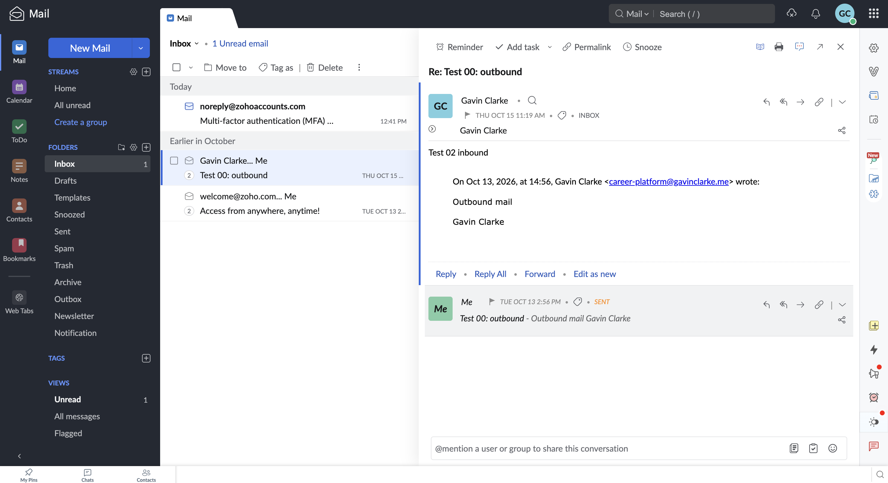

# Exercise 06: Custom-domain email with Zoho Mail

**Domain:** `gavinclarke.me` · **Mail provider:** Zoho Mail · **Outside mailbox:** iCloud Mail
**Address:** `career-platform@gavinclarke.me` · **DNS:** Cloudflare

**Why `career-platform@`:** I set up the mailbox under the project's name
while building this site, and every test and header below uses it. It's a
real, working address at my domain, so I kept it rather than redo the tests.
For a resume I'd add `gavin@gavinclarke.me` as an alias in Zoho; that needs
no DNS changes, because the MX, SPF, DKIM and DMARC records cover the whole
domain.

## 1. Email tests

Times are Pacific. Tests were run from Zoho webmail and the Zoho MCP server.

| Test | Time | Result |
|---|---|---|
| Before MX (outside → my domain) | — | Not done. I didn't send a message before publishing Zoho's MX records. The domain never had a moment with no mail records: from registration it had Namecheap's email-forwarding MX records (`eforward1`–`5.registrar-servers.com`, see [dns-before-zoho.md](dns-before-zoho.md)), which I replaced with Zoho's on 2026-10-13. A message sent before then would have gone to Namecheap's forwarder, not to Zoho. |
| Received (outside → Zoho) | 2026-10-15 11:19 PDT | Pass. "Re: Test 00: outbound" from the outside mailbox landed in the Zoho Inbox (screenshot below). |
| Replied (Zoho → outside) | 2026-10-20 12:42 PDT | Pass. "Re: Test 00: outbound" sent from Zoho arrived in the outside mailbox's Inbox. |
| Sent new message (Zoho → outside) | 2026-10-15 11:21 PDT | Pass. "Test 02: New Outbound" arrived in the outside mailbox's Inbox (`X-Apple-MoveToFolder: INBOX`, section 3). |
| Sender shown to the outside mailbox | 2026-10-15 | Pass. The received headers of "Test 02: New Outbound" show `From: Gavin Clarke <career-platform@gavinclarke.me>`. For the reply, Zoho's Sent folder shows it sent from `career-platform@gavinclarke.me`; I didn't save the iCloud side of the reply. |



## 2. Mail records

All are DNS only (not proxied) in Cloudflare, with the values Zoho gave for my
account. Checked on 2026-10-26; the public resolver `8.8.8.8` and Cloudflare's
`liz.ns.cloudflare.com` returned the same answers.

| Record | Name | Value | What it does |
|---|---|---|---|
| MX | `@` | `mx.zoho.com` (10), `mx2.zoho.com` (20), `mx3.zoho.com` (50) | Tells other mail servers to deliver mail for `@gavinclarke.me` to Zoho. The lowest number is tried first; the others are backups |
| SPF (TXT) | `@` | `v=spf1 include:zohomail.com ~all` | Lists the servers allowed to send mail as my domain: Zoho's. `~all` marks anything else as suspicious |
| DKIM (TXT) | `zmail._domainkey` | `v=DKIM1; k=rsa; p=MIGf…IDAQAB` | The public key for selector `zmail`. Zoho signs each outgoing message, and receivers check the signature with this key |
| DMARC (TXT) | `_dmarc` | `v=DMARC1; p=none; rua=mailto:career-platform@gavinclarke.me` | Asks receivers to check that SPF or DKIM passes *for my domain*, take no action yet (`p=none`), and send reports to me |
| Verification (TXT) | `@` | `zoho-verification=zb34999741.zmverify.zoho.com` | Proves to Zoho that I control the domain |

```text
$ dig @8.8.8.8 +noall +answer MX gavinclarke.me
gavinclarke.me.  300  IN  MX  10 mx.zoho.com.
gavinclarke.me.  300  IN  MX  20 mx2.zoho.com.
gavinclarke.me.  300  IN  MX  50 mx3.zoho.com.
$ dig @8.8.8.8 +noall +answer TXT gavinclarke.me
gavinclarke.me.  300  IN  TXT  "v=spf1 include:zohomail.com ~all"
gavinclarke.me.  300  IN  TXT  "zoho-verification=zb34999741.zmverify.zoho.com"
$ dig @8.8.8.8 +noall +answer TXT zmail._domainkey.gavinclarke.me
zmail._domainkey.gavinclarke.me.  600  IN  TXT  "v=DKIM1; k=rsa; p=MIGf…IDAQAB"
$ dig @8.8.8.8 +noall +answer TXT _dmarc.gavinclarke.me
_dmarc.gavinclarke.me.  300  IN  TXT  "v=DMARC1; p=none; rua=mailto:career-platform@gavinclarke.me"
```

Before Zoho, the zone had Namecheap's five forwarding MX records and an SPF
record for the forwarder, and no DKIM or DMARC
([dns-before-zoho.md](dns-before-zoho.md)). I removed the old MX records
because three of them shared priority 10 with `mx.zoho.com`, so some mail
would still have gone to the forwarder.

## 3. SPF, DKIM and DMARC

Results from the outside mailbox (iCloud) for "Test 02: New Outbound", taken from
its received headers. Signature values and spam-filter headers are trimmed.

```text
Authentication-Results: spf.icloud.com; spf=pass (spf.icloud.com: domain of career-platform@gavinclarke.me designates 165.173.182.52 as permitted sender) smtp.mailfrom=career-platform@gavinclarke.me
Authentication-Results: dkim-verifier.icloud.com; dkim=pass header.d=gavinclarke.me header.i=career-platform@gavinclarke.me
Authentication-Results: dmarc.icloud.com; dmarc=pass header.from=gavinclarke.me
X-DMARC-Info: pass=pass; dmarc-policy=none; s=r1; d=r1; pdomain=gavinclarke.me
DKIM-Signature: v=1; a=rsa-sha256; s=zmail; d=gavinclarke.me; …
```

| Check | Result |
|---|---|
| SPF | pass: Zoho's server `165.173.182.52` is allowed by `include:zohomail.com`. |
| DKIM | pass: signed by `d=gavinclarke.me` with selector `zmail`. |
| DMARC | pass: SPF and DKIM both aligned with `gavinclarke.me`. Policy is `p=none`. |

The full header analysis, with dates and the routing headers, is in
[zoho-header-check.md](zoho-header-check.md).

**Unresolved:** the before-MX message wasn't sent (section 1). DMARC stays at
`p=none`, so receivers report failures but don't block them; tightening it to
`p=quarantine` is the next step once reports look clean.

## 4. Website analytics

- Live site: <https://gavinclarke.me>
- Privacy page: <https://gavinclarke.me/privacy>

GA4 Realtime overview, 2026-10-20, after accepting analytics on the live site.


- **Shown:** `page_view` (3 events), and one outbound `click` on the LinkedIn
  link with its three parameters: `link_url`
  (`https://www.linkedin.com/in/gavin-clarke-81489329b`), `link_domain`
  (`linkedin.com`) and `outbound` (`true`). Realtime shows one parameter at a
  time, so each has its own screenshot.
