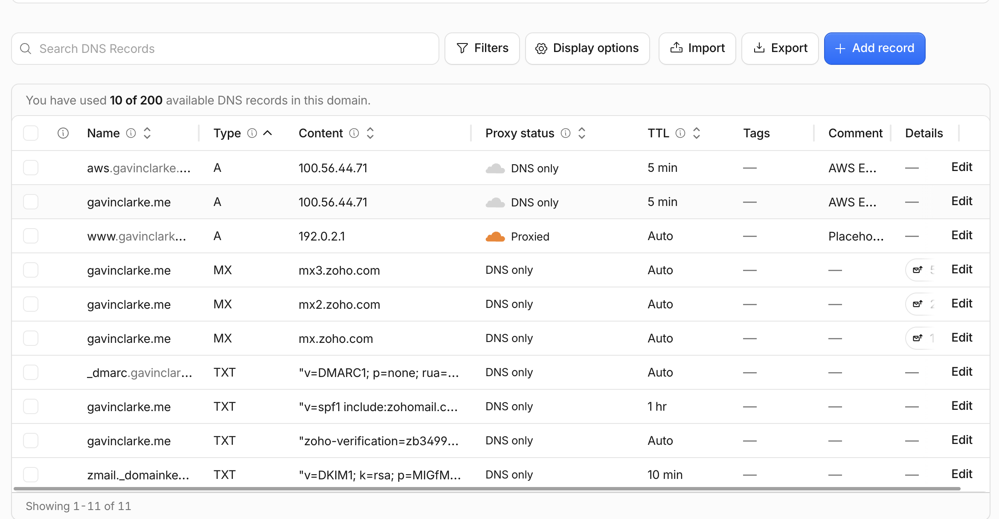
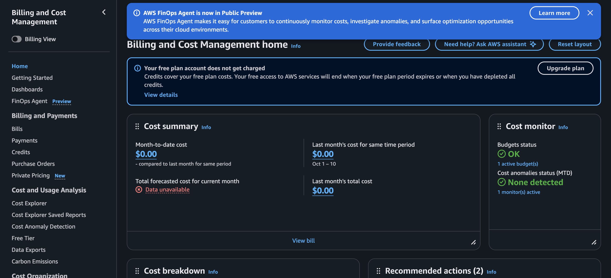

# Exercise 07: Moving gavinclarke.me to AWS

**Site:** `gavinclarke.me` · **Test subdomain:** `aws.gavinclarke.me` ·
**Region:** `us-east-1` · **Architecture diagram:**
[README, "Now: AWS EC2 + RDS"](../../README.md#now-aws-ec2--rds-since-2026-11-10)

Times are Pacific. The full step-by-step record is
[`docs/migration-notes.md`](../migration-notes.md).

## 1. Architecture decision

We chose one EC2 server (nginx and uvicorn) with a private, encrypted
PostgreSQL database on Amazon RDS, and rejected both PostgreSQL on the same
EC2 server and Lambda + API Gateway + RDS, accepting about $27 a month on
credits and a server to patch again in exchange for a managed, backed-up
database and a setup that teaches the core AWS services.

## 2. Backup record

| Item | Record |
|---|---|
| Backup date | **2026-11-03, 13:22**: `pg_dump -Fc` of Railway's PostgreSQL 18.6 (the last backup before Railway's trial ended on 2026-11-07; no content changed after it) |
| Restore test (2026-11-03) | **Pass.** Restored into a throwaway local PostgreSQL 18 as a non-superuser in 0.08 s. All 10 tables matched Railway's row counts and content fingerprints, and the app served every page from it |
| Restore into RDS (2026-11-10) | **Pass.** Same file, SHA-256 checked on the server. Every row (21 of 21) and every sequence value (9 of 9) on RDS is identical to the backup; Alembic at head with no change |
| Data loss we accept | **Up to 1 day.** RDS restores to any point in the last day. We planned 7 days, but the account's Free plan rejected more than 1 (`FreeTierRestrictionError`). Copies that must outlive that are exports stored outside AWS; one was made after the cutover |
| Recovery time we accept | **About 1 hour.** Rebuilding the server from `deploy/` and the migration notes, or restoring RDS to a point in time and pointing the app at the new database |
| Not yet verified | An RDS point-in-time restore has not been practised |

## 3. Test subdomain verification (`aws.gavinclarke.me`)

| What we tested | Evidence | Result |
|---|---|---|
| DNS record | Cloudflare: `aws` A record to the server's Elastic IP, DNS only; 1.1.1.1 and 8.8.8.8 both return it | Pass |
| HTTPS certificate | Let's Encrypt (`CN=YE2`), `subject=CN=aws.gavinclarke.me`, valid 2026-11-10 to 2027-02-08; `SSL certificate verify ok` over TLS 1.3 | Pass |
| Certificate renewal | `certbot renew --dry-run`: success; `certbot.timer` active | Pass |
| HTTP redirects to HTTPS | `curl -sI http://aws.gavinclarke.me/` → `301 Moved Permanently`, path kept | Pass |
| All public pages | Home, resume, projects, contact, privacy and the 4 project pages: 200, about 0.23 s each | Pass |
| Content comes from RDS | `/health`: `"database":"healthy","fallback":false`; the 4 project titles and profile name on the pages match the database | Pass |
| Static files | CSS, fonts, favicon, consent script: 200 with the right types | Pass |
| `/admin` closed | `GET /admin`, `GET /admin/profile`, `PUT /admin/profile`: 404 | Pass |
| Unknown pages | `/does-not-exist`, unknown project: 404 with the site's "Page not found" page | Pass |
| Kept out of search | `X-Robots-Tag: noindex, nofollow` on the test name only | Pass |
| Nothing else exposed | Bare IP gets no response on 80 or 443; app port 8000 and the database unreachable from outside; the database connection uses TLS | Pass |
| Survives a reboot | After `sudo reboot`, app and nginx came back on their own; `/health` healthy, 0 restarts since | Pass |
| nginx version hidden | First `Server: nginx/1.28.3 (Ubuntu)` on the HTTP redirect. Now `Server: nginx` on HTTP and HTTPS | **Failed, then fixed** (see below) |

**Failed check: nginx version.** We tried adding `server_tokens off;` in a
separate `conf.d` file. `nginx -t` rejected it, because Ubuntu 26.04's
`nginx.conf` already sets `server_tokens build;`, and the reload failed too;
nginx kept serving the old config, so the site never went down. Next step,
done the same day: removed the file, backed up `nginx.conf`, changed that line
to `off`, reloaded only after `nginx -t` passed, and re-ran the header check.

## 4. Cutover status

**Done on 2026-11-10 at about 12:05.** In Cloudflare, `gavinclarke.me` (`@`)
changed from the Railway CNAME to an A record for the Elastic IP, DNS only;
no other record changed. The certificate was expanded to cover
`gavinclarke.me`, the renewal test passed, and a mail send-and-reply test
passed afterwards.

## 5. Cost

| | Amount |
|---|---|
| Our estimate ([`costs.md`](../costs.md)) | **≈ $26.82 a month**: EC2 t3.micro $7.59, its 20 GB disk $1.60, RDS db.t4g.micro $11.68, RDS storage $2.30, public IPv4 $3.65. Paid from $100 of Free-plan credits, which last until about 2027-03-03; we plan a cheaper setup by the end of February 2027 |
| Billing page now (2026-11-10, 12:44) | **$0.00 month-to-date**, last month $0.00, forecast "Data unavailable". The page says "Your free plan account does not get charged. Credits cover your free plan costs." The EC2 and RDS resources were created the same morning, and AWS billing data lags by up to a day, so their usage hadn't appeared yet. A budget is active and no cost anomalies were detected |

