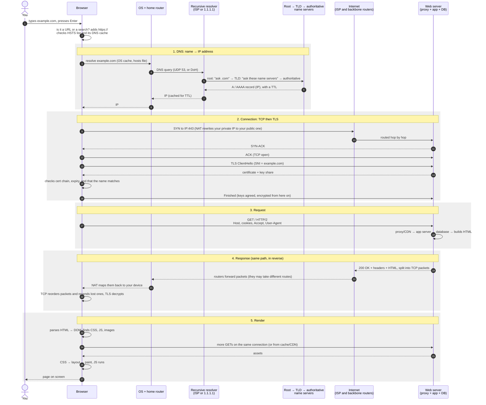
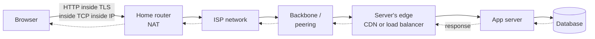

# What happens when you open a website

What happens between typing a domain, pressing Enter, and seeing the page.

## The request and response, step by step

## The path across the network

## Key points

- **DNS only returns an address.** After the first lookup, every cache along
  the way (browser, OS, resolver) keeps the answer until its TTL runs out, so
  later visits skip step 1.
- **The response follows the request's path backwards.** It's addressed to your
  public IP and port, and your router's NAT table sends it to your device.
  Individual packets can take different routes, and TCP puts them back in
  order.
- **Each layer has one job:** IP gets packets to the machine, TCP makes the
  delivery reliable and ordered, TLS encrypts it and proves the server's
  identity, and HTTP carries the request itself.
- **One page means many requests.** The first response is just HTML. The
  browser then fetches the CSS, JavaScript and images, usually over the same
  connection.
